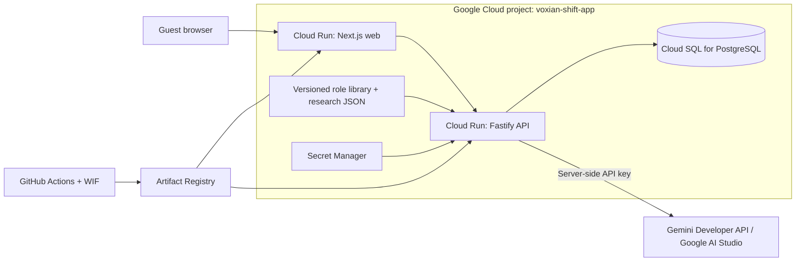

# Voxian Shift — Pitch Deck Write-up (AI Builder Cup)

Copy for each slide in "Voxian Shift | Submission Template | AI Builder Cup". Items in [brackets] need your input before submission.

---

## 1. Team Details

- **Team name:** Voxian Shift
- **Team leader name:** [Name]
- **Problem statement:** Workers in clerical, administrative and frontline service roles hear that AI will take their jobs, but they can't see which parts of their work are actually changing or what to do about it. Most of them have no access to labour-market research or a career coach. Voxian Shift is an AI-powered early-warning and career adaptation platform. It shows how exposed each task in a person's job is to generative AI, using public ILO research, then turns that evidence into a personal reskilling plan.
- **Track:** Sustainability & Social Impact

---

## 2. Brief about the idea

**Warn people about what is changing. Show them the evidence. Help them prepare before the change catches up with them.**

Voxian Shift treats a job as a set of tasks rather than one unit. A worker enters their job title or uploads a CV. We match them to an official occupation and show:

- **The Meter:** how exposed their tasks are to generative AI, scored against the ILO's task-level research.
- **The Curve:** where adoption is heading, with observed evidence kept separate from labelled scenarios.
- **The Navigator:** realistic career directions from their current role, with the best-fit role picked from their CV.
- **The Tracker:** a Gemini-generated plan they commit to and track day by day.

Users leave with a plan, not a doom score.

---

## 3. Opportunities

### How different is it from other existing ideas?

- **Task-level, not job-level.** Most "will AI take my job" tools give one opaque percentage. We show which tasks drive the score and why.
- **Evidence-first.** Exposure scores come from the ILO's published task assessments (Working Paper 140, May 2025), mapped from O\*NET occupations to ISCO-08 units. Gemini does not invent the numbers.
- **From warning to action.** Disruption dashboards stop at the diagnosis. We continue to a career map, a costed learning path and a tracked plan.
- **No job-loss countdown.** We don't show fake "years until your job disappears" clocks. Scenarios are labelled as scenarios.

### How will it solve the problem?

1. **Lower the barrier:** no sign-up. Type a job title or upload a CV, and the AI matches the closest official occupation.
2. **Explain the risk honestly:** a transparent exposure score with sources, task by task.
3. **Show realistic options:** four strategies (Automate, Hybrid, Pivot, Create), each with destination roles, skills, a day-to-day picture, and free and paid courses.
4. **Turn intent into habit:** a schedule-aware 90- or 120-day plan, a daily tracker, and Lumi, an AI career copilot that answers questions in context.

### USP of the proposed solution

**An evidence-grounded journey from occupation to tasks to a personal plan, where deterministic research data sets the score and Gemini personalises the response.**

---

## 4. List of features offered by the solution

| Feature                   | What it does                                                                                                                           |
| ------------------------- | -------------------------------------------------------------------------------------------------------------------------------------- |
| Guided onboarding         | Job title search over official occupations, or CV upload (PDF/DOC/DOCX/TXT). The main role is set to the closest match automatically.  |
| CV understanding          | Gemini extracts job titles, skills, duties and keywords. The user reviews them before use. The file and raw text are not stored.       |
| The Meter                 | Task-level exposure score from ILO WP140 data, with the exposure gradient, per-task breakdown and source citation                      |
| The Curve                 | Dated adoption evidence on one timeline, separate from clearly labelled future scenarios                                               |
| The Navigator             | Interactive career canvas: present role, then four strategies, then destination roles. Opens on the role that best fits the user's CV. |
| Role details              | Day-to-day work, "your human edge", skills to build, a bridge project, and free and paid learning resources                            |
| CV alignment              | Shows which required skills are evidenced in the CV, with the supporting evidence quoted                                               |
| AI flight plan            | Gemini generates a phased plan (structured JSON, validated) fitted to the user's weekly hours and timeline                             |
| The Tracker               | Day-by-day sessions, activity log and progress against the committed plan                                                              |
| Lumi copilot              | Context-aware chat assistant on every page, with saved history                                                                         |
| Methodology & Proof       | Sources, assumptions and limitations, in one place                                                                                     |
| Privacy and cost controls | Anonymous guest profile, reset any time, rate limits, and a budget kill switch on the cloud project                                    |

---

## 5. Process flow diagram / Use-case diagram

```
Worker
  │
  ├─► Onboarding ──► [Type job title]  or  [Upload CV ─► Gemini extraction ─► user review]
  │                        │                               │
  │                        └──────► Occupation match (O*NET ─► ISCO-08) ◄──┘
  │                                          │
  ├─► The Meter ◄──── ILO WP140 task exposure scores (deterministic)
  │
  ├─► The Curve ◄──── dated adoption evidence + labelled scenarios
  │
  ├─► The Navigator ──► 4 strategies ─► destination roles ─► best-fit role from CV
  │         │
  │         └─► "Build this direction into a plan" ─► schedule (hours, days, timeline)
  │                                                     │
  │                                                     ▼
  │                                     Gemini API (Google AI Studio) ─► validated phased plan
  │                                                     │
  └─► The Tracker ◄─────────────────────────────────────┘   (daily sessions, progress)

Lumi copilot is available at every step to answer questions in context.
```

---

## 6. Wireframes / Mock diagrams (optional)

Use screenshots from the live app instead of wireframes (see slide 10). Suggested order: Onboarding, Meter, Navigator canvas with role panel, Plan, Tracker.

---

## 7. Architecture diagram of the proposed solution



Gemini handles CV extraction, personalized guidance, plan generation and Lumi. Its API also supplies Lumi memory embeddings. Optional CV-to-skill vector retrieval is disabled in current production; its separate Vertex implementation remains available for future activation.

**Design rule:** deterministic data owns the numbers and Gemini owns the language. Every model output is validated against a schema before it is shown. Model HTML is never rendered.

---

## 8. Technologies to be used in the solution

- **Google AI:** Gemini Developer API, using Google AI Studio credentials, for CV understanding, personalized career guidance, plan generation and Lumi and Gemini API embeddings (Lumi semantic memory; optional CV-vector retrieval is disabled in current production)
- **Google Cloud:** Cloud Run (web and API), Cloud SQL for PostgreSQL, optional pgvector support, Artifact Registry, Pub/Sub, Cloud Billing budgets, IAM with Workload Identity Federation
- **Frontend:** Next.js 16 (App Router), React 19, Tailwind CSS v4, shadcn/ui (Radix), React Flow (@xyflow/react)
- **Backend:** Node.js, Fastify 5, Zod (shared request and response contracts)
- **Tooling:** Vite+ monorepo (pnpm workspaces), TypeScript, Vitest, GitHub Actions
- **Data:** ILO Working Paper 140 (May 2025) task exposure scores, O\*NET occupations, ISCO-08 classification

---

## 9. Estimated implementation cost (optional)

| Item                                    | Prototype cost                                                                                                                                                     |
| --------------------------------------- | ------------------------------------------------------------------------------------------------------------------------------------------------------------------ |
| Cloud Run (web + API, min instances 0)  | Within free tier (2M requests and 180,000 vCPU-seconds a month)                                                                                                    |
| Cloud SQL for PostgreSQL (db-f1-micro)  | Free for 3 months on the Blaze no-cost trial, then from about USD 9.37 a month                                                                                     |
| Gemini Developer API (Google AI Studio) | Usage billed according to configured project/key tier. Rate limits reduce request volume but do not guarantee zero cost.                                           |
| **Budget alert / shutdown automation**  | **RM21 monthly project budget recorded 18 October 2026; delayed alerts and shutdown automation are not a hard cap or a guarantee covering all Gemini API billing** |

**Scale path:** keep Cloud Run scale-to-zero. Move to a paid Cloud SQL tier, then add Firebase Auth account linking so progress follows the user across devices.

---

## 10. Snapshots of the prototype

[Insert screenshots from https://voxian-web-184581024855.asia-southeast1.run.app]

1. Onboarding: job title search, or CV upload with the review panel
2. The Meter: exposure score, gradient and task breakdown, with the ILO citation
3. The Curve: evidence timeline and labelled scenarios
4. The Navigator: career canvas with the CV-matched role selected and the details panel open
5. AI plan: phased plan sheet
6. The Tracker: today's session and progress
7. Lumi copilot answering a question about the user's role

---

## 11. Prototype Performance report / Benchmarking

**Data coverage**

- 865 O\*NET occupations mapped to 427 ISCO-08 units
- 3,264 ILO task-level exposure scores behind the Meter

**Quality and reliability**

- 255 automated tests passing across web, API and shared packages (scoring, CV matching, plan validation, rate limiting, data isolation)
- Frozen evaluation sets for CV-to-skill matching (matching, holdout and frozen requirements), so changes to matching can be regression-checked
- Every Gemini response is schema-validated. Failures show a clear retry state, never a fake success.

**Responsiveness**

- Cloud Run scale-to-zero. Navigator paths are cached per session, so revisits load instantly.
- [Add measured numbers if you have them: cold start, plan-generation time, CV processing time]

---

## 12. Additional Details / Future Development

- **Account linking** (Google or email) so progress follows the user across devices
- **More roles and regions:** expand the curated pathway library and add Malaysia and JAPAC-specific labour data alongside the global ILO index
- **Employer and community partners:** cohort dashboards for training providers, unions and HR teams helping people through reskilling
- **Verified outcomes:** track completed bridge projects and credentials, and measure transitions over time
- **Multilingual support:** Bahasa Malaysia and other regional languages

---

## 13. Links

- **GitHub Public Repository:** https://github.com/voxianshift/voxian-shift-dashboard [confirm the repository is public]
- **Demo Video Link (3 minutes):** [YouTube or Drive link]
- **Final Product Link:** https://voxian-web-184581024855.asia-southeast1.run.app

## Current AI provider note — verified 19 October 2026

Production API selects `CHAT_PROVIDER=gemini` and `GEMINI_MODEL=gemini-3.8-flash`. CV extraction, Navigator personalization, learning-plan generation and Lumi share Gemini Developer API (Google AI Studio credentials). Lumi semantic-memory embeddings use the same API provider. The Meter remains deterministic. Optional CV-to-skill pgvector retrieval still has a Vertex implementation but is off in current production; do not pitch it as an active production capability. Model name records configured value, not an availability guarantee.

Pitch process diagram: [transparent PNG](docs/diagrams/voxian-process-flow-gemini.png).
